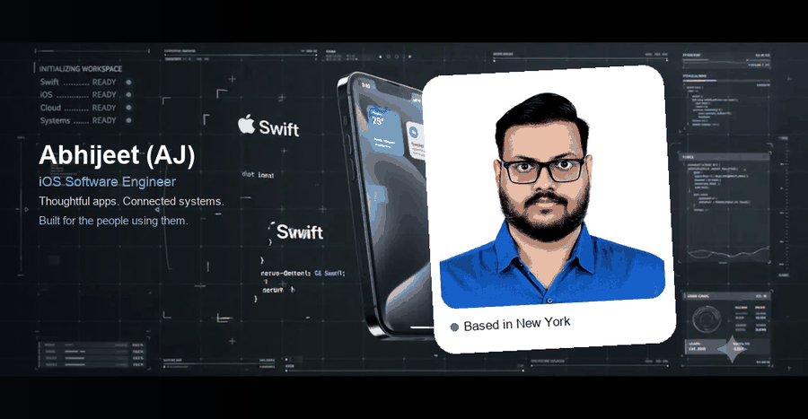
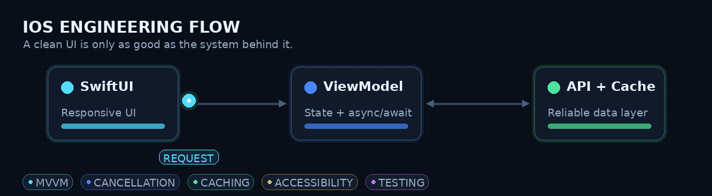
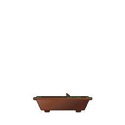

<div align="center">



<br/>

I build across the Apple ecosystem — from SwiftUI interfaces to real-time cloud services.  
Based in New York. Currently building at ZenZiee.

<br/>

<a href="https://abhijeet1999.github.io/Portfolio/"></a>
<a href="mailto:abhijeetcherungottil@gmail.com"></a>
<a href="https://www.linkedin.com/in/abhijeetcherungottil/"></a>
<a href="https://github.com/abhijeet1999"></a>

</div>

---

## A little about me

```swift
struct Abhijeet: iOSEngineer {
    let alsoKnownAs = "AJ"
    let location = "New York"
    let role = "iOS Engineer & Technology Consultant"
    let currentlyBuilding = "ZenZiee — iPhone, WidgetKit, watchOS + Go/AWS"
    let path = ["QBurst", "Marist (M.S. Cloud Computing)", "ZenZiee"]
    let stack = ["Swift", "SwiftUI", "UIKit", "watchOS", "Go", "AWS"]
}
```

I’m Abhijeet (AJ), an iOS engineer and technology consultant. I enjoy working across the whole product: the interface someone touches, the systems behind it, and the details that make it accessible.

After nearly three years building and shipping Swift and UIKit apps at **QBurst**, I completed my **M.S. in Computer Science** (cloud computing) at Marist. Today I work on iOS and cloud services at **ZenZiee**, alongside consulting and community projects.

---

## How I build

<p align="center">
  
</p>

| Focus | How it shows up |
| --- | --- |
| **Delightful UI** | SwiftUI-first, UIKit when it fits, Dynamic Type, VoiceOver, RTL, adaptive layouts |
| **Maintainable architecture** | MVVM, clear boundaries, testable view models, explicit dependencies |
| **Reliable systems** | async/await, cancellation, cache-aware networking, offline and error states |
| **Human impact** | Accessibility in product work — S.P.A.R, Marist Digital Education, One Earth One Chance |

---

## Selected work

<small>Small details. Complete experiences.</small>

<table>
  <tr>
    <td width="50%" valign="top">
      <h3>✳ ZenZiee</h3>
      <p><em>iOS × real-time systems</em></p>
      <p>Five-friend iOS social app with messaging and live activity across iPhone, widgets, and Apple Watch — backed by Go services on AWS.</p>
      <code>SwiftUI</code> · <code>MVVM</code> · <code>Go</code> · <code>AWS</code> · <code>WidgetKit</code>
    </td>
    <td width="50%" valign="top">
      <h3><a href="https://github.com/abhijeet1999/MSCS_Spring2025_Capping">▥ S.P.A.R</a></h3>
      <p><em>Systems × mobile</em></p>
      <p>Accessible iOS interface for monitoring Linux CPU, memory, disk, and processes — with VoiceOver and Dynamic Type treated as part of the layout.</p>
      <code>SwiftUI</code> · <code>Electron</code> · <code>Spring Boot</code> · <code>MySQL</code>
    </td>
  </tr>
  <tr>
    <td width="50%" valign="top">
      <h3>◉ Thermal vision</h3>
      <p><em>iOS × computer vision</em></p>
      <p>Thermal image analysis and mask-fit exploration on iOS with FLIR One, CoreML, and a UIKit + SwiftUI workflow.</p>
      <code>Swift</code> · <code>UIKit</code> · <code>SwiftUI</code> · <code>FLIR</code> · <code>CoreML</code>
    </td>
    <td width="50%" valign="top">
      <h3> Maarist Digital education</h3>
      <p><em>Accessibility × web</em></p>
      <p>Accessible learning resources and faculty workflows for Marist University’s Digital Education team — including LMS QA and inclusive course adaptations.</p>
      <code>Accessibility</code> · <code>Liferay</code> · <code>Brightspace</code> · <code>Panopto</code>
    </td>
  </tr>
</table>

<p align="center">
  <a href="https://abhijeet1999.github.io/Portfolio/#/work">Explore all projects on my portfolio →</a>
</p>

---

## Beyond the interface

| | |
| --- | --- |
| **3 years** | Building iOS at QBurst — shipping Swift and UIKit apps with multidisciplinary teams |
| **3 surfaces** | One connected experience at ZenZiee — iPhone, WidgetKit, and Apple Watch |
| **Access first** | VoiceOver & Dynamic Type in S.P.A.R, accessible learning at Marist, nonprofit tech at One Earth One Chance |

---

## The toolkit

From the first view to the last API call.

<div align="center">


<br/><br/>


</div>

<br/>

**Apple platforms** — Swift · SwiftUI · UIKit · WidgetKit · watchOS · CoreML · SceneKit · Vision  
**Cloud & systems** — Go · AWS · WebSocket · AppSync · REST APIs · Spring Boot · MySQL  
**Product & access** — VoiceOver · Dynamic Type · LMS QA · Power Apps · Power Automate

---

## Experience

| Where | Role | When |
| --- | --- | --- |
| **ZenZiee** | Senior iOS Developer · Technical Consultant | Apr 2026 – present |
| **QBurst** | Software Engineer (iOS) | Aug 2021 – Jul 2024 |
| **Marist University** | Digital Education Consultant / LMS QA | Sep 2024 – Dec 2025 |
| **One Earth One Chance** | Technology consultant · volunteer | Dec 2025 – present |
| **Wonderhunt Corp** | Mobile QA Tester · freelance | 2026 (completed) |
| **Dash Level** | Freelance Software Engineer | Mar – Apr 2026 |

---

## GitHub activity

<div align="center">
  
  
</div>

<p align="center">
  
</p>

<p align="center">
  <a href="https://github.com/egorthinks/git-bonsai"></a>
</p>

---

<div align="center">

## Something good starts with hello

Have an iOS product, a technical challenge, or an opportunity in mind?  
I’d love to hear about it.

<a href="mailto:abhijeetcherungottil@gmail.com"></a>
<a href="https://abhijeet1999.github.io/Portfolio/"></a>
<a href="https://www.linkedin.com/in/abhijeetcherungottil/"></a>

<br/><br/>

<sub>Built with care. Always learning. · <a href="https://abhijeet1999.github.io/Portfolio/">abhijeet1999.github.io/Portfolio</a></sub>

</div>
